<div align="center">

# VAULTX / Drop 07 Curfew

**A dystopian streetwear store in black and white. Clean shop up front, viewfinder underneath.**

A concept e-shop for a Prague label: a greyscale video hero with live tracker boxes and glitch bursts, a calm product grid, mirrored editorial bands with hairline grids and scattered small text, and a complete simulated shop with filters, bag, custom checkout, Google or email accounts and a help desk. One React single-page app, every route prerendered.

[**Open the live site**](https://denysovski.github.io/VaultX/) &nbsp;·&nbsp; [New arrivals](https://denysovski.github.io/VaultX/shop/) &nbsp;·&nbsp; [Product](https://denysovski.github.io/VaultX/shop/breach-leather-jacket/) &nbsp;·&nbsp; [Help](https://denysovski.github.io/VaultX/help/)


<br>

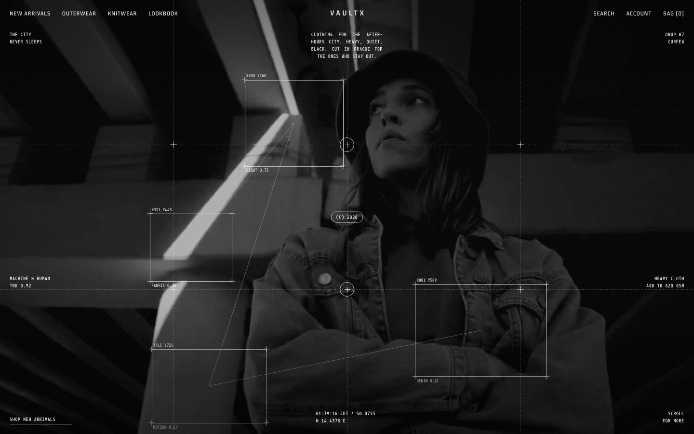

</div>

---

## At a glance

| | |
|---|---|
| **Concept** | Two layers. The shop layer follows the quiet structure of distopion.com and demobaza.com: centred wordmark, category words in a row, a plain product grid, small tracked caps for names and prices. The second layer comes from a viewfinder moodboard: dotted hairline grid, + markers, circle markers, scattered mono text, tracker boxes, glitches and blur. |
| **Colour** | Black, white and greys only. The video, the lookbook and every product photo are shown in greyscale. |
| **Type** | No heavy headers. The biggest words on the site (categories) are Expose 400. Product names are 12 px tracked capitals; all small HUD text is RX100. |
| **Landing** | Full-screen video in greyscale with a canvas on top: up to four tracker boxes follow the brightest and most-moving areas of each frame, labelled with a tag, a confidence value and coordinates, plus a short glitch burst every few seconds. Live Prague clock, scrambling text, a mirrored editorial band, outerwear row, community block. |
| **Shop** | Category scroller, search, bigger or smaller cards, and a side panel for sort, size and availability. Filters live in the URL. |
| **Product** | Sticky image with drifting tracker brackets, front and fabric-detail views, size grid with stock, restock alert for sold-out sizes, size guide, delivery dates, mobile buy bar. |
| **Accounts** | Sign in with Google, or email and password. Both create a local account in `localStorage`. Google tokens are verified in the browser before they are trusted (see Security). |
| **Checkout** | Custom fields, select, radios and checkbox; card formatting with Luhn, expiry and CVC checks; promo codes; a decline test card; draft saved for the tab. |
| **Help** | Track an order, report a late, missing, damaged or wrong delivery (with photo), returns, FAQ, contact. |
| **Motion** | Pages enter with a short fade, lift and un-blur. Cards and form fields rise in with a small stagger. Images arrive from a blur. Header hides on scroll down and returns on scroll up (always visible on phones). Reduced motion turns all of it off, including the video effects. |

---

## Style

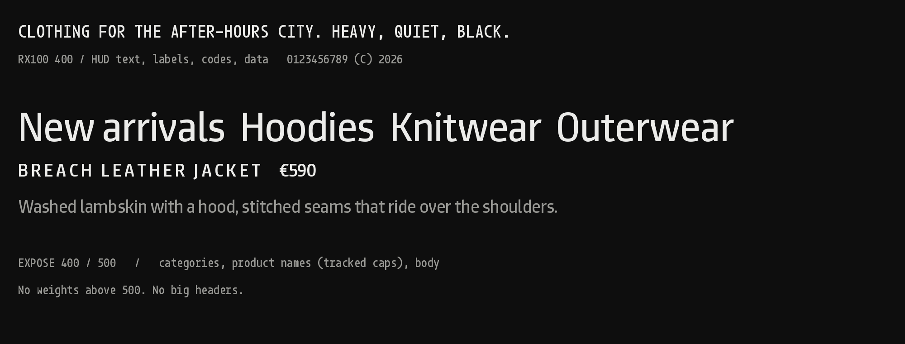

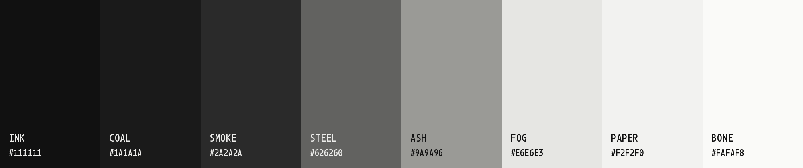

| Token | Hex | Use |
|---|---|---|
| `--ink` | `#111111` | text, buttons |
| `--coal` | `#1A1A1A` | dark cards |
| `--smoke` | `#2A2A2A` | dark surfaces |
| `--steel` | `#626260` | muted text on light (5.4:1) |
| `--ash` | `#9A9A96` | muted text on dark |
| `--fog` | `#E6E6E3` | lines, skeletons |
| `--paper` | `#F2F2F0` | page background |
| `--bone` | `#FAFAF8` | raised panels |

**Product photos.** The images come from different sources with different backgrounds and crops, so each one is measured once (`scripts/fit-products.mjs`): the script finds the garment's bounding box and the backdrop tone and stores a scale, an offset and a brightness lift in `src/data/fit.json`. Every product then sits centred in the same 4:5 frame, at the same size, in greyscale, with its backdrop multiplied away into the card colour.

---

## Home

| | |
|---|---|
|  **Hero.** Greyscale video, tracker boxes, glitch bursts, viewfinder grid and small text. |  **New arrivals.** Category words in a row and the product grid. |
| 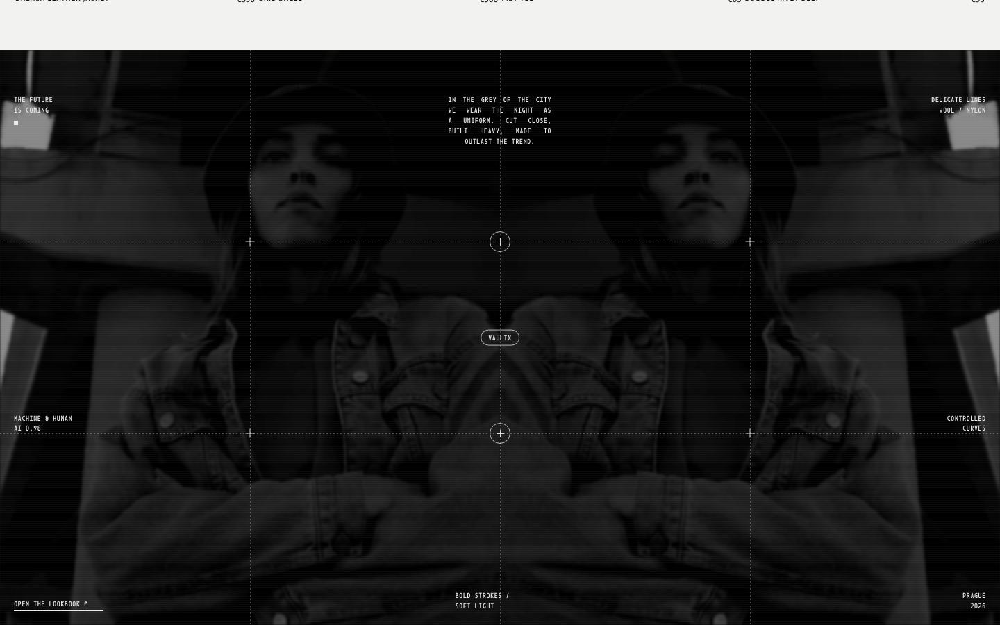 **Mirror.** A video frame mirrored down the middle, scanlines, un-blurs as it enters. | 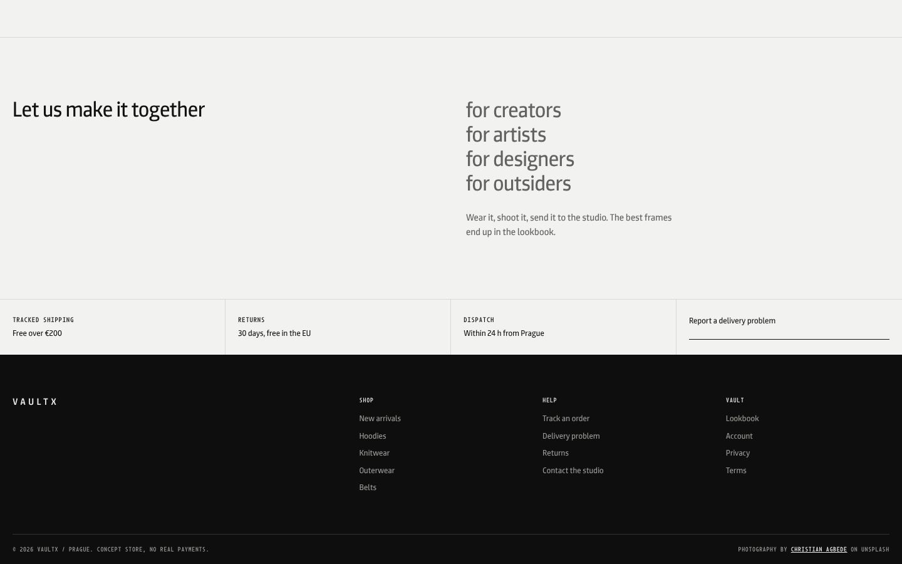 **Community and promises.** Shipping, returns, dispatch, a link to report a delivery problem. |

## Shop and product

| | |
|---|---|
|  **Shop.** Search, card size toggle, product count. | 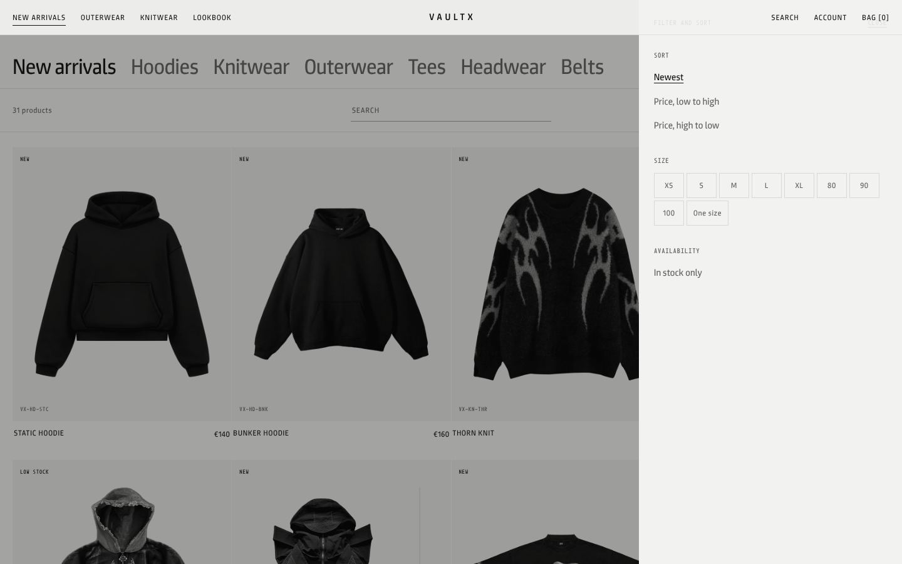 **Filter and sort.** Side panel in plain text. |
|  **Product.** Tracker brackets drift over the garment. | 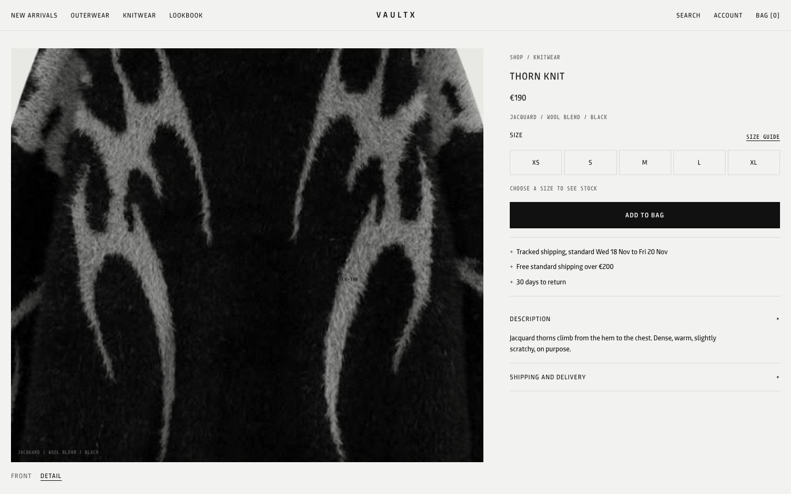 **Detail view.** The same photo zoomed to the fabric. |
| 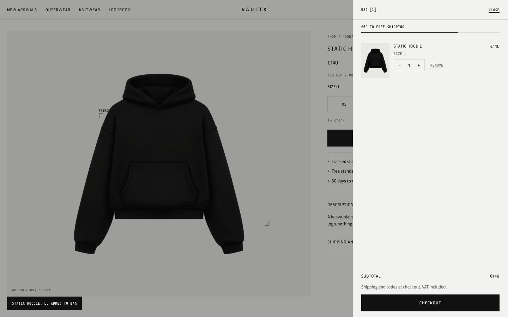 **Bag.** Drawer with free-shipping line and steppers. | 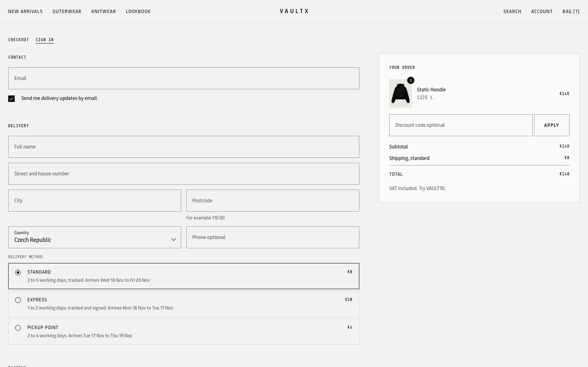 **Checkout.** Custom fields and delivery methods with real dates. |

## Account, help, lookbook

| | |
|---|---|
| 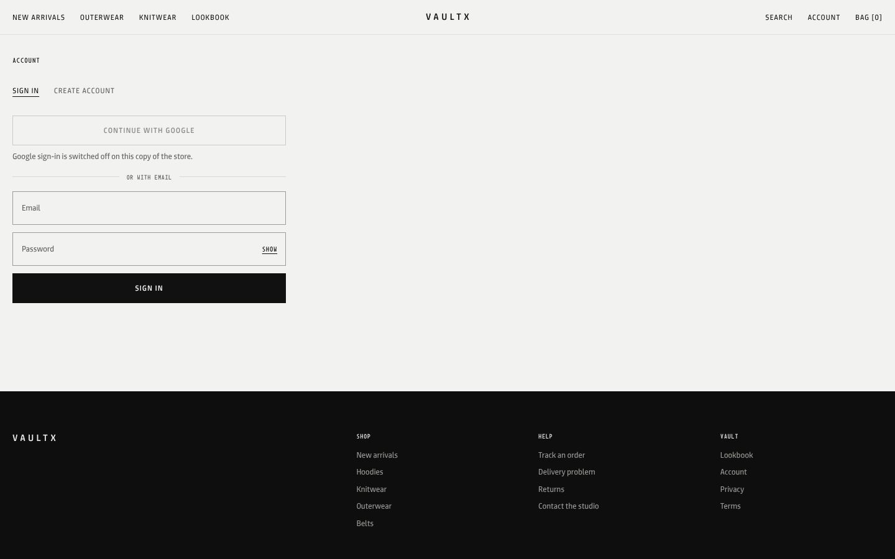 **Account.** Google button above the email form. | 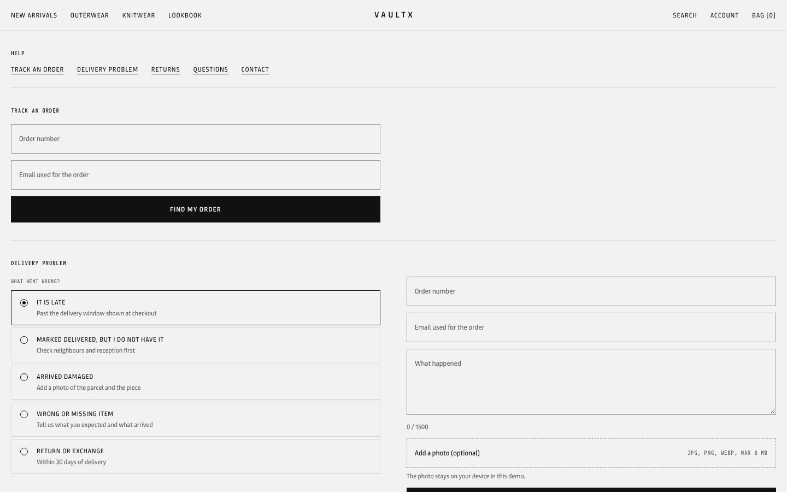 **Help.** Tracking and delivery problems. |
| 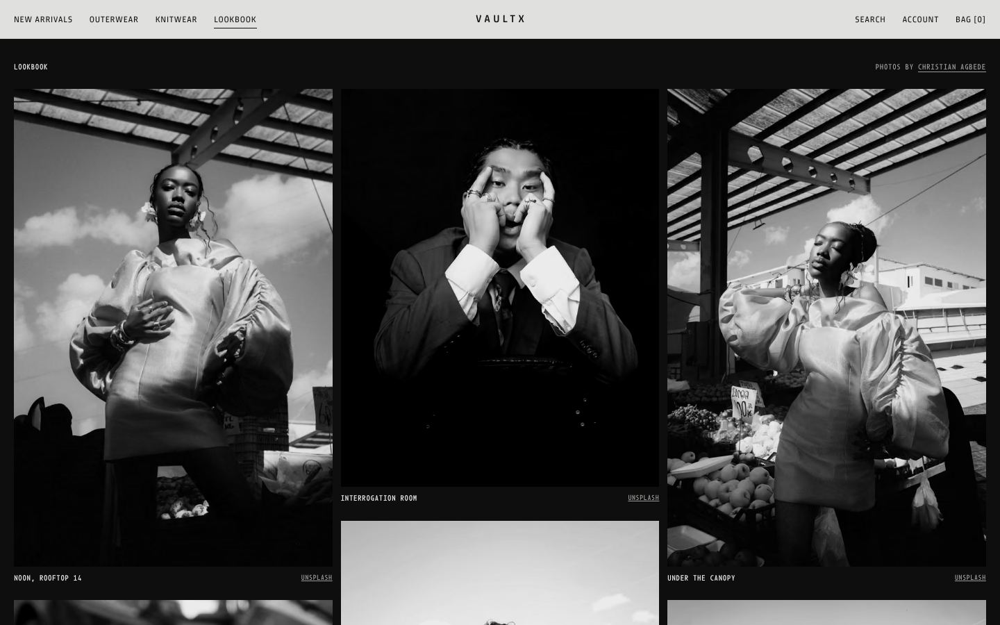 **Lookbook.** Greyscale photos, the grid appears on hover. | 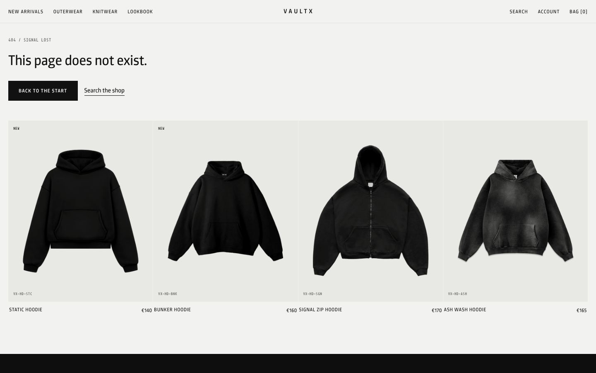 **404.** Signal lost, with a way back. |

## Mobile

| | | | |
|:---:|:---:|:---:|:---:|
| 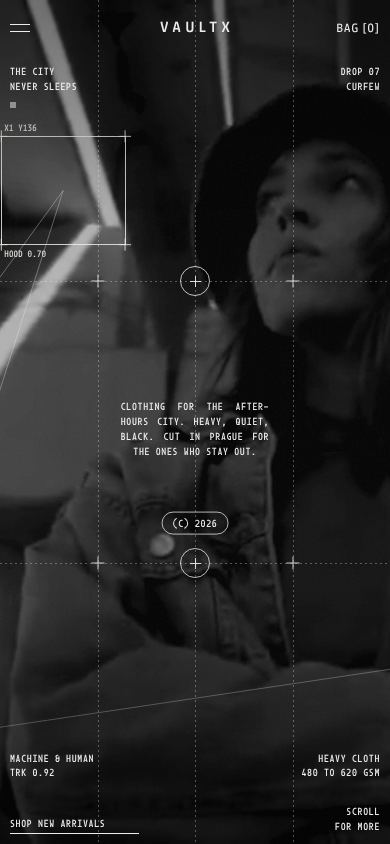<br><sub>Hero</sub> | <br><sub>Menu</sub> | <br><sub>Shop</sub> | <br><sub>Product</sub> |

---

## Sign in with Google

The button uses Google Identity Services. To switch it on:

1. In Google Cloud Console, open **APIs & Services → Credentials → Create credentials → OAuth client ID**, type **Web application**.
2. Add **Authorized JavaScript origins**: `https://denysovski.github.io` and `http://localhost:5173`.
3. Copy the client ID. Locally put it in `.env` (see `.env.example`); for the live site add it as a repository variable `VITE_GOOGLE_CLIENT_ID` (Settings → Secrets and variables → Actions → Variables). The client ID is public by design; no secret is needed.

Without a client ID the button is shown disabled and email accounts keep working.

## Security

Front end only, so every check happens in the browser:

| Check | How |
|---|---|
| Google ID token | RS256 signature verified against Google's published keys; issuer, audience (this client ID), expiry, issue time and a one-time nonce checked; email must be verified. `alg: none`, tampered payloads, foreign keys, other audiences, expired and replayed tokens are rejected. The token is never stored. `npm test` runs these cases against a locally generated key. |
| Account linking | A verified Google email links to an existing email account; a different Google account can't take over an email already linked. |
| Passwords | PBKDF2-SHA256, 210 000 iterations, 16-byte random salt, constant-time compare, equal timing for unknown emails, 128-character cap. |
| CSP | `script-src 'self'` plus only `accounts.google.com/gsi/client`; images only from this site and `i.pinimg.com`; frames only from Google's sign-in. No inline scripts in any prerendered page; an injected inline script is blocked. |
| Input | Markup in search and form fields renders as text, names reject markup, control characters are stripped, lengths are capped. `?next=` after sign-in only accepts same-site paths. |
| Cards | Never stored or sent. Orders keep brand and last four digits. |
| Dependencies | `npm audit`: 0 vulnerabilities. CI runs audit and tests before every deploy. |

Limits of a static demo: `localStorage` can be read by any script on the origin, and GitHub Pages cannot send headers, so the CSP is a meta tag (no `frame-ancestors`). A real store needs a server for accounts and orders.

## Audits

Lighthouse 13 on the production build. Product photos were blocked in the test sandbox, which shows up as console errors in Best Practices; everything else is as measured.

| Page | Performance (mobile / desktop) | Accessibility | Best practices | SEO |
|---|---|---|---|---|
| Home | 95 / 100 | 100 | 96 | 100 |
| Shop | 100 / 99 | 100 | 96 | 100 |
| Product | 100 / 100 | 100 | 96 | 100 |
| Help | 100 / 100 | 100 | 100 | 100 |
| Account | 100 / 100 | 100 | 100 | noindex on purpose |

CLS is 0 everywhere. Every public route has its own title, description, canonical URL, Open Graph image and JSON-LD (Organization, WebSite, ItemList, Product, BreadcrumbList, FAQPage), plus `sitemap.xml`, `robots.txt` and `llms.txt`. The hero video is 0.5 MB (from a 9.3 MB original), 0.25 MB on phones.

## XSlop

Built with my [XSlop](https://github.com/denysovski/XSlop) rulebook. This rebuild also made `SL-17` a hard rule there: no decorative counting anywhere (no 01 / 02 / 03 on sections, cards, photos or form steps). Numbers on this site are data only: prices, sizes, stock, dates, coordinates and confidence values.

## Under the hood

- **React 19 + TypeScript + Vite 8**, React Router, `react-dom/static` prerendering with chunk preloading before hydration
- **Canvas effects** (`src/components/Hud.tsx`): frame analysis on a 64 × 36 copy about 12 times a second, paused off screen and in background tabs
- **No UI kit**, one stylesheet with tokens, Vitest for the auth checks

```
src/pages/        Home, Shop, Product, Lookbook, Checkout, OrderDone, Account, Help, Legal, NotFound
src/components/   Nav, Hud (video, tracker, glitch, grid, scramble), Bag, Field, ProductCard, Img
src/lib/          auth (PBKDF2 + Google), google (ID token checks), store, validate, storage
src/data/         products, looks, fit.json (image framing), images.json
scripts/          prerender.mjs, fit-products.mjs, optimize-images.mjs
public/video/     hero.mp4, hero-960.mp4, poster and still
```

```bash
npm install
npm run dev       # http://localhost:5173/VaultX/
npm test          # Google token verification tests
npm run build     # type-check, build, prerender every route into dist/
```

Pushing to `main` tests, builds and publishes `dist/` to the `gh-pages` branch. Pages source: **Deploy from a branch → gh-pages / root**.

---

## Credits

- **Product images** are hotlinked from Pinterest search results (queries such as "png clothes", "png black hoodie", "png knit sweater black", "png beanie", "png belt leather"). They are not stored in this repository and all rights stay with their owners. Product names, prices and stock are invented. Replace them with your own photography before any commercial use.
- **Hero video** supplied by the repository owner, converted to greyscale and re-encoded.
- **Lookbook photography** by [Christian Agbede](https://unsplash.com/@chriscreations__) on Unsplash, under the [Unsplash License](https://unsplash.com/license); each photo links to its source on the page.
- **Fonts** [RX100](https://www.fontshare.com/fonts/rx-100) and [Expose](https://www.fontshare.com/fonts/expose) from Fontshare (ITF Free Font License).
- **Layout references** distopion.com and demobaza.com (structure only; no text or images were copied).

---

<div align="center"><sub>Concept store built as a portfolio project. No products are sold and no payments are taken.</sub></div>
