<div align="center">

# VAULTX / Drop 07 Curfew

**Dystopian streetwear for the after-hours city. Black, white and every grey in between.**

A luxury concept store for a Prague streetwear label: a giant travelling wordmark, colourful street photography against a monochrome shell, and a complete simulated shop with filters, bag, custom checkout, accounts and a help desk. One single-page app, every route prerendered.

[**Open the live site**](https://denysovski.github.io/VaultX/) &nbsp;·&nbsp; [Shop](https://denysovski.github.io/VaultX/shop/) &nbsp;·&nbsp; [Product](https://denysovski.github.io/VaultX/shop/bunker-hoodie/) &nbsp;·&nbsp; [Help](https://denysovski.github.io/VaultX/help/)


<br>


</div>

---

## At a glance

| | |
|---|---|
| **Style** | `BLACK COAL + MEGA TYPE, minimal` from my [XSlop](https://github.com/denysovski/XSlop) style keywords. Monochrome shades (never pure #000 or #fff), colour only from photos and garments, oversized type in empty space, plain-text navigation with no dropdown menus. |
| **Pages** | Home, Shop, Product (7 pieces, 16 colourways), Lookbook, Checkout, Order confirmation, Account, Help, Privacy, Terms and 404. One SPA with client routing, every public route also prerendered to static HTML. |
| **Shop** | Filters for category, colour, size, sort and stock, kept in the URL so they can be shared. Debounced search, zero-result state, mobile filter sheet. |
| **Product** | Colour swatches, size grid with live stock, restock alert for sold-out sizes, size guide dialog, dispatch countdown and delivery dates, sticky add-to-bag bar on phones. |
| **Checkout** | Fully custom fields: floating labels, custom select with keyboard support, radio cards, card number formatting and Luhn check, expiry and CVC rules, promo codes, a test card that declines. Draft saved for the tab, card data never stored. |
| **Account** | Register and sign in with `localStorage`. Passwords hashed with PBKDF2 (210 000 iterations, random salt), 7-day sessions, order history with simulated status. |
| **Help** | Order tracking by number and email, a delivery problem form (late, marked delivered, damaged with photo, wrong item, return), returns steps, FAQ and contact. |
| **Motion** | Nav hides on scroll down and returns on scroll up (always visible on phones), animated hamburger, the VAULTX wordmark that follows you down and docks, masked image reveals, one scroll-linked type line. All of it respects reduced motion. |

---

## Style

**Typography.** Two Fontshare families. RX100 is the dystopian mono: the wordmark, labels, prices and codes. Expose carries headlines and reading text in four weights (400, 500, 700, 900), so the page moves from heavy uppercase blocks to quiet body copy without a third font.


**Palette.** Eight shades from ink to bone. No pure black and no pure white anywhere. Light sections sit on Paper, dark ones on Ink; the colour on the page comes from the photography and the garments themselves (acid shell, flare and coolant tees). One functional red (`#B3321B`) is kept for errors only.


| Token | Hex | Use |
|---|---|---|
| `--ink` | `#121211` | dark sections, text on light, primary buttons |
| `--coal` | `#1B1B1A` | footer, dark tiles |
| `--graphite` | `#2C2C2A` | hover on dark buttons, dark product tiles |
| `--steel` | `#5C5C58` | muted text on light (5.6:1 on Paper) |
| `--ash` | `#9D9D98` | muted text on dark (6.9:1 on Ink) |
| `--fog` | `#D4D3CE` | product stages, skeletons |
| `--paper` | `#EBEAE6` | page background, text on dark |
| `--bone` | `#F5F4F0` | raised panels, light product stages |

**Layout.** Full width with an 8 to 16 px gutter on both sides, 4 px gaps between tiles, sharp corners, hairlines only where they separate data.

---

## Home

| | |
|---|---|
|  **Hero.** Four garments on alternating shades. The VAULTX wordmark sits at the bottom of the screen in difference blend, so it inverts over every tile. | 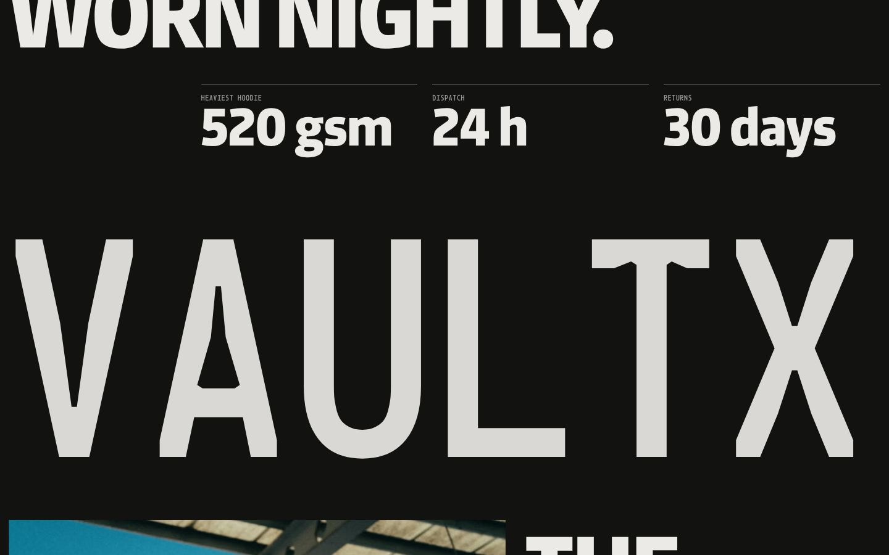 **The dock.** The wordmark follows the scroll and lands in its default position at the end of the dark block. Pure CSS `position: sticky`, no scroll listeners. |
| 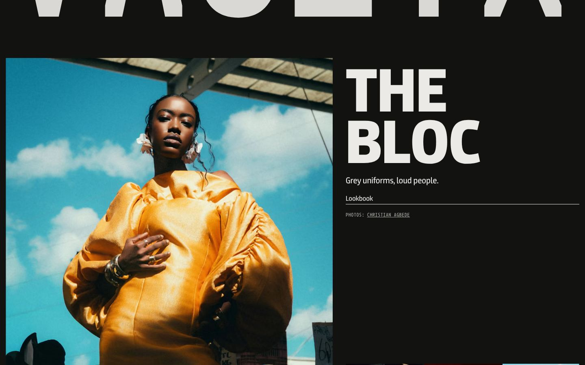 **The bloc.** Colourful street photography against the grey shell, revealed with a clip-path mask. | 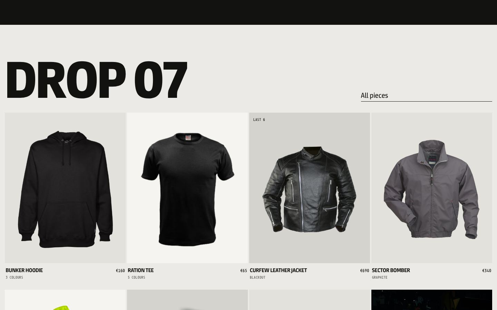 **Drop 07.** All seven pieces, stock flags on low sizes, a lookbook tile closing the grid. |
| 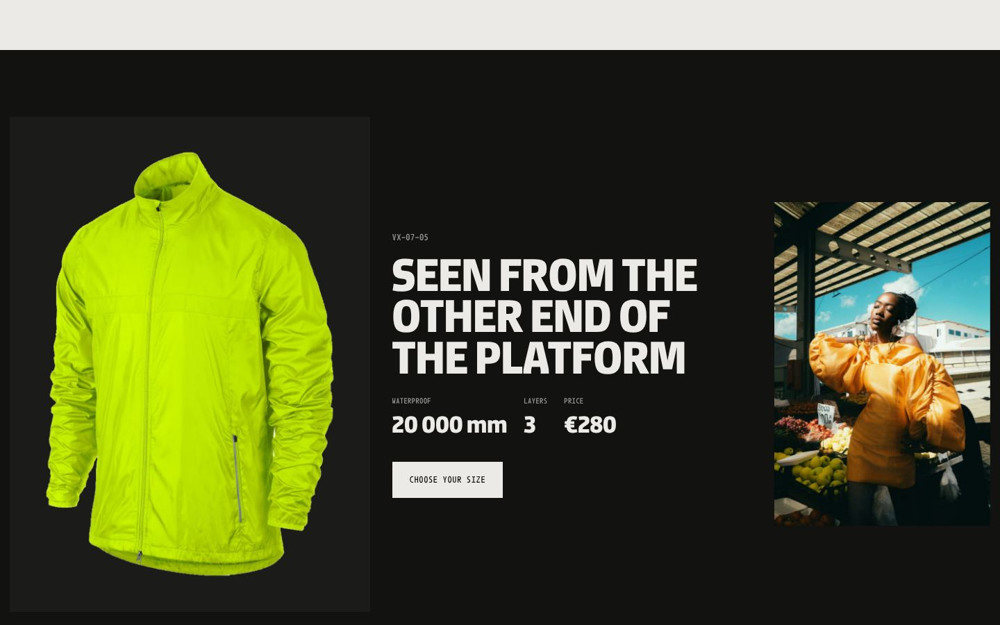 **Feature.** The one loud piece with its numbers. | 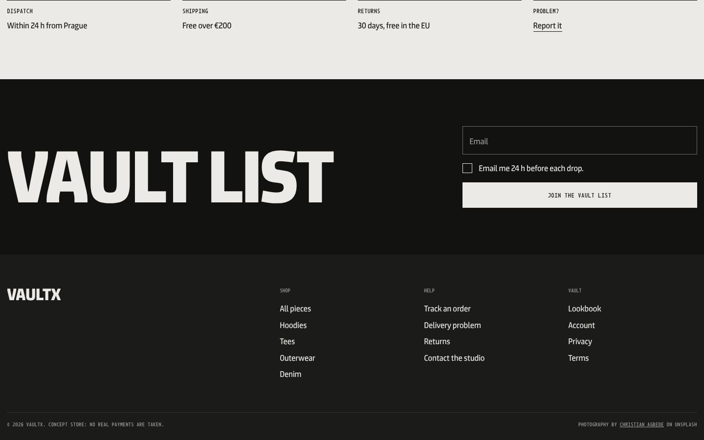 **After you order.** Dispatch, shipping, returns and a link to report a problem, then the vault list signup. |

---

## Shop, product and checkout

| | |
|---|---|
| 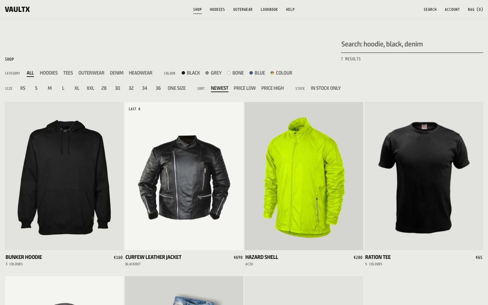 **Shop.** Plain-text filters, no dropdowns. Search waits 250 ms after the last key. | 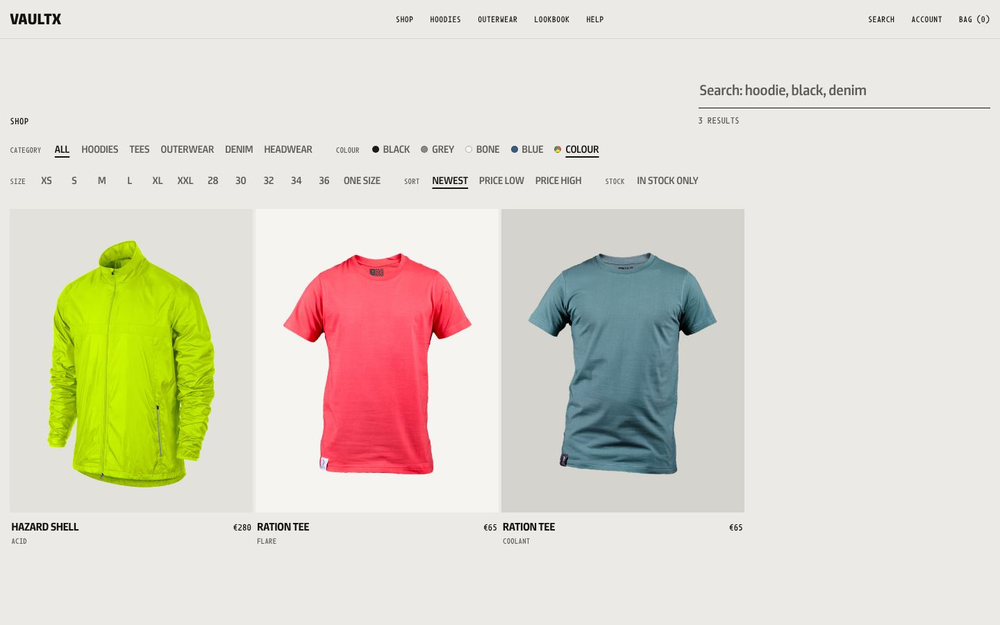 **Colour filter.** Filtering by colour shows the matching colourway on every card. |
| 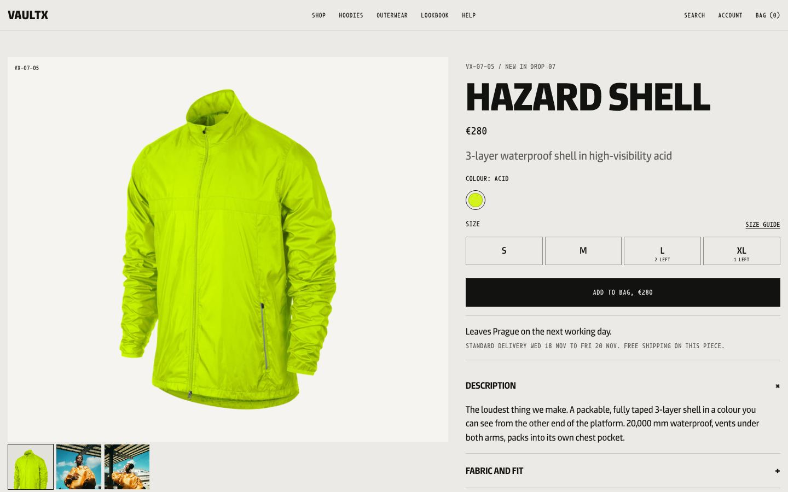 **Product.** Gallery with mood photos, swatches, sizes with stock left, dispatch countdown. | 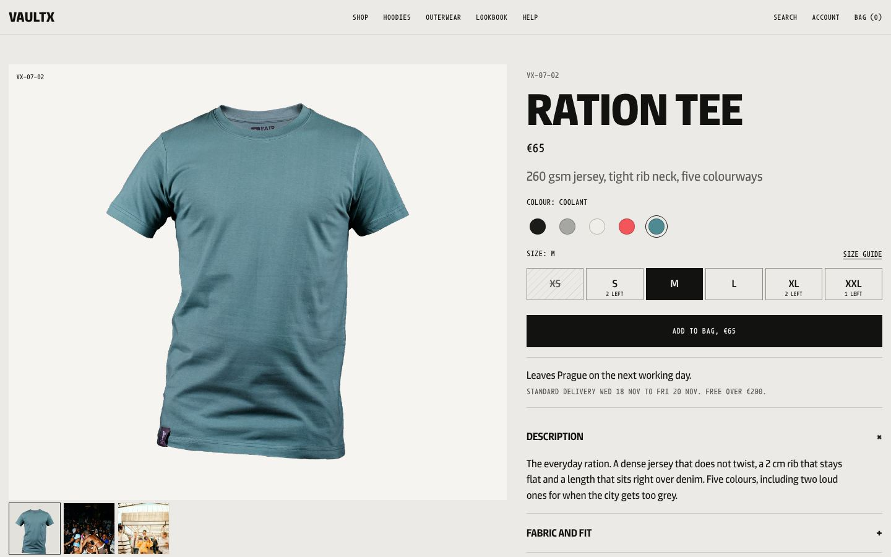 **Colourways.** Switching colour crossfades the garment and updates the URL. |
| 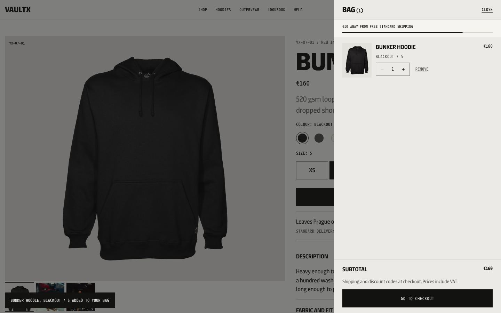 **Bag.** Slide-in drawer with focus trap, free-shipping meter and quantity steppers. | 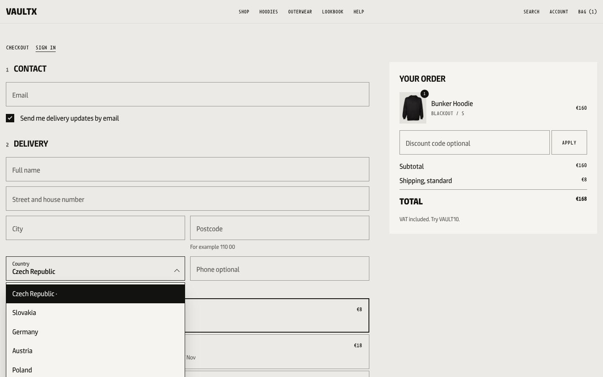 **Checkout.** Custom inputs and select, delivery dates per method, order summary with promo codes. |

## Help, lookbook and account

| | |
|---|---|
| 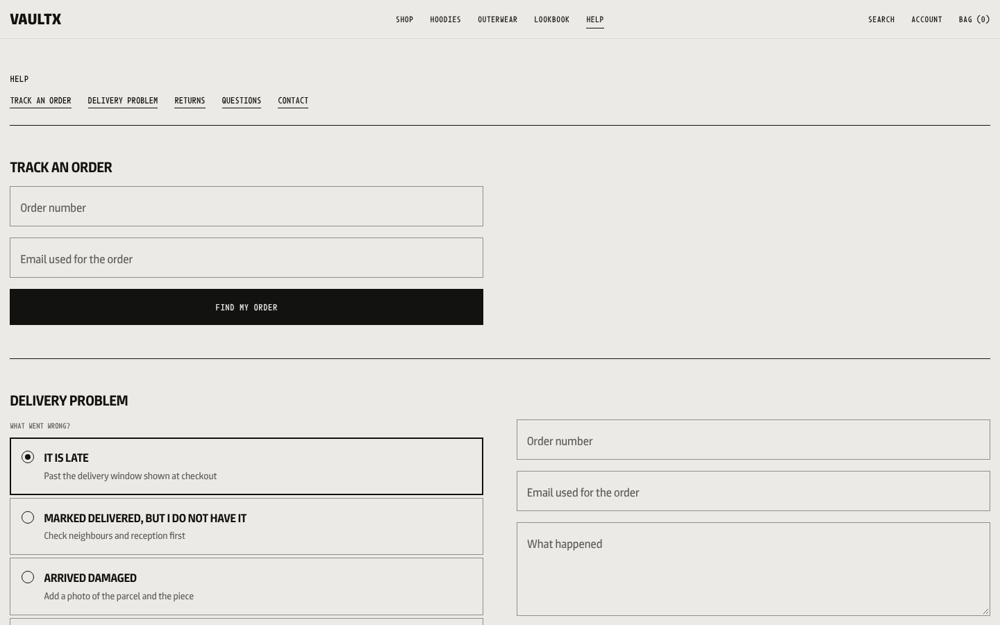 **Help.** Track an order with its number and email. | 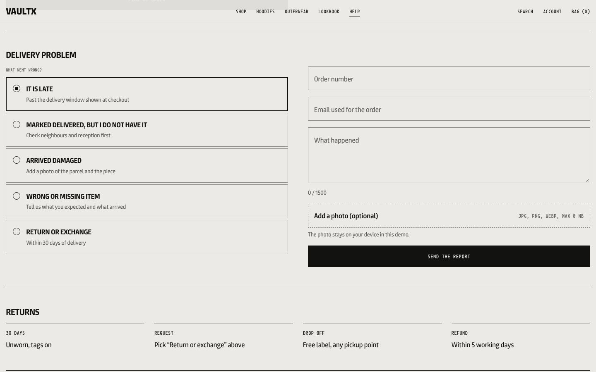 **Delivery problem.** Five issue types; a damaged parcel asks for a photo (type and size checked). |
|  **Lookbook.** Fifteen frames, every one credited and linked to Unsplash. | 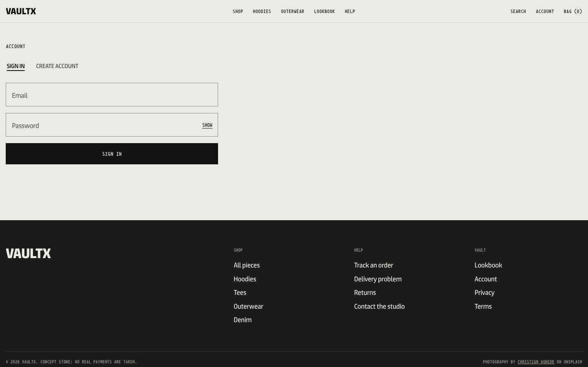 **Account.** Sign in or create an account; orders appear with live simulated status. |

## Mobile

| | | |
|:---:|:---:|:---:|
| <br><sub>Hero</sub> | 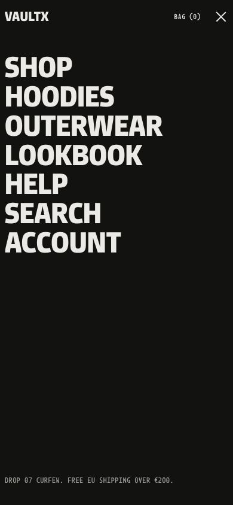<br><sub>Menu, always-visible bar</sub> | 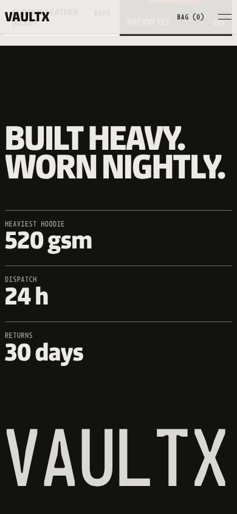<br><sub>Wordmark docked</sub> |
| <br><sub>Shop</sub> | 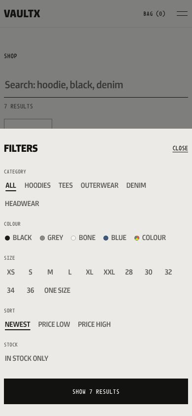<br><sub>Filter sheet</sub> | <br><sub>Product</sub> |

---

## Try the demo checkout

- Card **4242 4242 4242 4242**, any future expiry, any 3-digit code
- Card **4000 0000 0000 0002** shows the bank-declined state
- Codes **VAULT10** (−10 %) and **CURFEW** (−15 %)
- Nothing is charged and nothing leaves your browser. Bag, accounts, orders and help requests live in `localStorage`.

## Audits

Run on the production build (`vite preview`), Lighthouse 13, November 2026.

| Page | Mobile perf | Desktop perf | Accessibility | Best practices | SEO |
|---|---|---|---|---|---|
| Home | 100 | 100 | 100 | 100 | 100 |
| Shop | 93 | 100 | 100 | 100 | 100 |
| Product | 94 | 100 | 100 | 100 | 100 |
| Help | 100 | 100 | 100 | 100 | 100 |
| Lookbook | 90 | 100 | 100 | 100 | 100 |
| Checkout | 97 | 100 | 100 | 100 | noindex on purpose |

CLS is 0 to 0.003 on every page. Mobile scores are with Lighthouse's simulated slow 4G.

**SEO.** Every public route is prerendered with its own title, description, canonical URL, Open Graph image and JSON-LD (Organization, WebSite with search, ItemList, Product with offers, BreadcrumbList, FAQPage). One H1 per page, ordered headings, alt text on every image, `sitemap.xml`, `robots.txt`, `llms.txt`, web manifest and favicon set. Checkout, account and order pages are `noindex`.

**Security.** Checks that were run, and what they found:

| Check | Result |
|---|---|
| `npm audit` (all and production deps) | 0 vulnerabilities |
| Content Security Policy | `script-src 'self'`, no inline scripts in any page (React prerender is told not to stream inline chunks). An injected inline script is blocked. |
| XSS through inputs and URL | Markup in the search query and form fields renders as text; names reject markup. No `dangerouslySetInnerHTML`; JSON-LD is escaped at build time. |
| Open redirect | `?next=//evil.example` after sign-in is ignored, only same-site paths are followed. |
| Passwords | PBKDF2-SHA256, 210 000 iterations, 16-byte random salt, constant-time compare, same timing for unknown emails. Never stored in plain text. |
| Card data | Never stored or sent. The order keeps brand and last four digits only. |
| Uploads | Image type and 8 MB limit checked; the file never leaves the device. |
| Third parties | None at runtime. Fonts and images are self-hosted, so no requests go to other domains. |

Limits that come with a static demo: `localStorage` can be read by anything running on the origin, and GitHub Pages cannot send security headers, so the CSP is a meta tag (no `frame-ancestors`). A real store would put accounts and orders behind a server.

## XSlop rules applied

Built with my [XSlop](https://github.com/denysovski/XSlop) rulebook on top of the brief:

- **Slop avoided:** no purple gradients, glow orbs, glass cards, bento grids, three-card rows, emojis, fake testimonials or lorem ipsum. Mono only for data and labels (`SL-25`, kept on purpose for the RX100 look).
- **Design craft:** token palette and type scale (`DC-05`), tabular numbers on every price (`DC-18`), balanced headline wrapping (`DC-16`), AA contrast (`DC-15`).
- **Motion:** ease-out entrances, 150 to 250 ms selects, press scale 0.97, exits shorter than entrances, masked reveals, reduced motion respected (`MO-01` to `MO-17`).
- **States:** empty bag, loading skeletons, offline bar, zero results, inline validation with focus on the first error, declined payment, expired session, success pages (`ST-01` to `ST-10`).
- **Production:** custom 404, legal pages, storage notice instead of a cookie banner (there are no cookies), sticky mobile CTA, OG image, favicon set (`PE`), plus the full `SEO` and `PF` lists above.

## Under the hood

- **React 19 + TypeScript + Vite 8**, React Router for client routing
- **Prerendering:** `react-dom/static` renders each route at build time; the client hydrates the same markup, preloading the route's code chunk first so nothing flashes
- **Code splitting:** every page except Home is its own chunk
- **Images:** AVIF + WebP at 3 widths with real dimensions (`scripts/optimize-images.mjs`, sharp). The 15 photos went from about 1 MB JPEGs to 60 to 120 KB AVIFs at 1080 px; LCP images are preloaded per route
- **Fonts:** five self-hosted WOFF2 files (18 KB each), preloaded, `font-display: swap`
- No UI library, no CSS framework, no state library. One stylesheet with tokens.

```
src/pages/        Home, Shop, Product, Lookbook, Checkout, OrderDone, Account, Help, Legal, NotFound
src/components/   Nav, Bag drawer, Field / Select / RadioCards / Check / Stepper, ProductCard, Img
src/lib/          store (bag, orders, toasts), auth (PBKDF2), validate, storage, hooks
src/data/         products, looks (photo credits), images.json (generated)
src/seo.ts        titles, descriptions, canonical URLs, JSON-LD for every route
scripts/          optimize-images.mjs, prerender.mjs
public/           img (AVIF/WebP), fonts, icons, robots.txt, llms.txt, og.jpg
```

## Run it locally

```bash
npm install
npm run dev       # dev server on http://localhost:5173/VaultX/
npm run build     # type-check, build, prerender every route into dist/
npm run preview   # serve the production build
```

Pushing to `main` builds the site and publishes `dist/` to the `gh-pages` branch. In **Settings → Pages**, the source should be *Deploy from a branch: gh-pages / root*. For a root domain build with `BASE=/ npm run build`.

---

## Credits and licences

**Photography: [Christian Agbede](https://unsplash.com/@chriscreations__) on Unsplash.** All 15 lifestyle photos are his, used under the [Unsplash License](https://unsplash.com/license) (free to use; credit given here and on the site).

| Photo | Used on |
|---|---|
| [Yellow puff-sleeve dress, blue sky](https://unsplash.com/photos/aqLw4av7NNM) | Home (The bloc), Hazard Shell |
| [Man with scarf and white shirt](https://unsplash.com/photos/ROmQBWVwEls) | Bunker Hoodie |
| [Woman posing inside a car](https://unsplash.com/photos/50M2OkPKHdY) | Home, Bunker Hoodie |
| [Crowd at a concert](https://unsplash.com/photos/MCEIUEsj918) | Home tile, Ration Tee |
| [Black shirt and rings](https://unsplash.com/photos/JiKUrya050w) | Curfew Leather Jacket |
| [Man in suit, hands on face](https://unsplash.com/photos/ONcme2-tWTs) | Home, Curfew Leather Jacket |
| [Orange dress with oranges](https://unsplash.com/photos/AvNRrrZjNaI) | Blackout Cap |
| [Yellow dress, pink crates](https://unsplash.com/photos/ssTQhwslygs) | Home, Sector Bomber |
| [Reading a magazine at the market](https://unsplash.com/photos/Yp_haKwhKc0) | Ration Tee |
| [Yellow dress among vegetables](https://unsplash.com/photos/lZpFUKTC0VQ) | Grid Denim |
| [Off-the-shoulder dress at a fruit stall](https://unsplash.com/photos/xjNQnmNQAQE) | Home feature, Hazard Shell |
| [Holding an orange](https://unsplash.com/photos/yDwkENz3DRo) | Sector Bomber |
| [Holding oranges at a stall](https://unsplash.com/photos/4wdXcijtVPc) | Lookbook |
| [Covering her face at the market](https://unsplash.com/photos/03mrPUPguNU) | Blackout Cap |
| [Posing among fresh produce](https://unsplash.com/photos/vqvoACWLNQY) | Grid Denim |

**Garment cut-outs: [pngimg.com](https://pngimg.com/)**, licensed [CC BY-NC 4.0](https://creativecommons.org/licenses/by-nc/4.0/) (non-commercial, attribution). Files used: [hoodie_PNG19](https://pngimg.com/uploads/hoodie/hoodie_PNG19.png), [hoodie_PNG30](https://pngimg.com/uploads/hoodie/hoodie_PNG30.png), [hoodie_PNG4](https://pngimg.com/uploads/hoodie/hoodie_PNG4.png), [tshirt_PNG5427](https://pngimg.com/uploads/tshirt/tshirt_PNG5427.png), [tshirt_PNG5448](https://pngimg.com/uploads/tshirt/tshirt_PNG5448.png), [tshirt_PNG5434](https://pngimg.com/uploads/tshirt/tshirt_PNG5434.png), [tshirt_PNG5449](https://pngimg.com/uploads/tshirt/tshirt_PNG5449.png), [tshirt_PNG5450](https://pngimg.com/uploads/tshirt/tshirt_PNG5450.png), [jacket_PNG8025](https://pngimg.com/uploads/jacket/jacket_PNG8025.png), [jacket_PNG8047](https://pngimg.com/uploads/jacket/jacket_PNG8047.png), [jacket_PNG8051](https://pngimg.com/uploads/jacket/jacket_PNG8051.png) (third-party logo removed), [jeans_PNG5779](https://pngimg.com/uploads/jeans/jeans_PNG5779.png), [jeans_PNG5778](https://pngimg.com/uploads/jeans/jeans_PNG5778.png), [cap_PNG5685](https://pngimg.com/uploads/cap/cap_PNG5685.png), [cap_PNG5688](https://pngimg.com/uploads/cap/cap_PNG5688.png). Product names, prices and stock are invented.

**Fonts: [RX100](https://www.fontshare.com/fonts/rx-100) and [Expose](https://www.fontshare.com/fonts/expose) from Fontshare** by the Indian Type Foundry, under the ITF Free Font License.

---

<div align="center"><sub>Concept store built as a portfolio project. No products are sold and no payments are taken.</sub></div>
