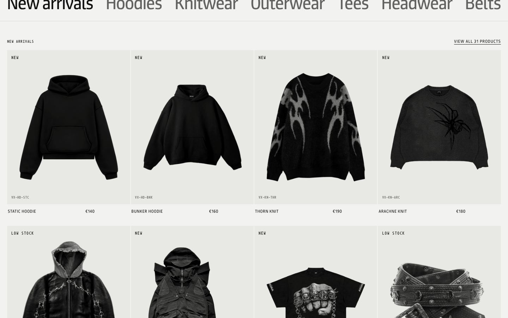
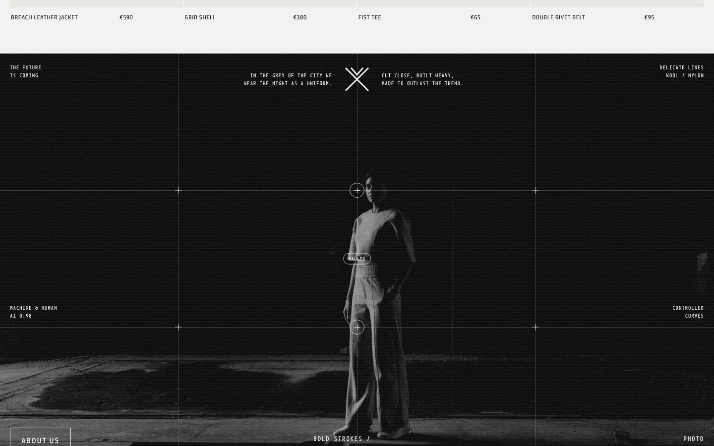
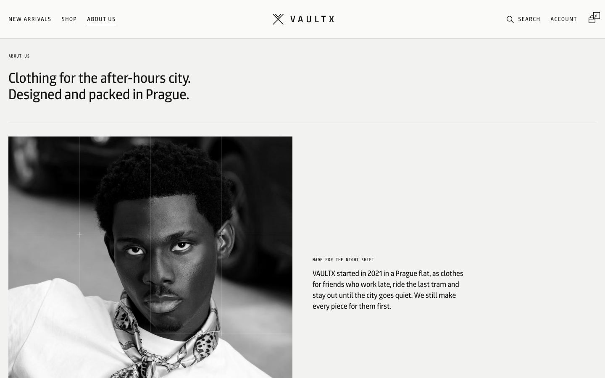
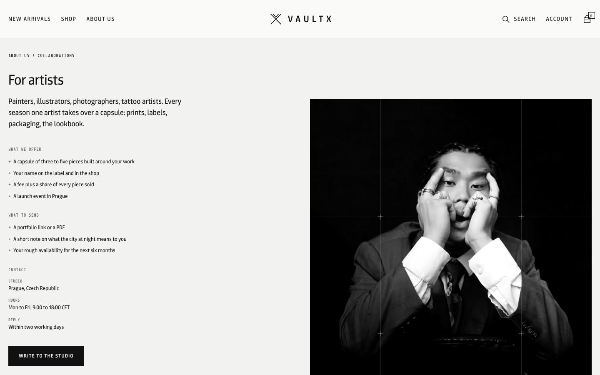
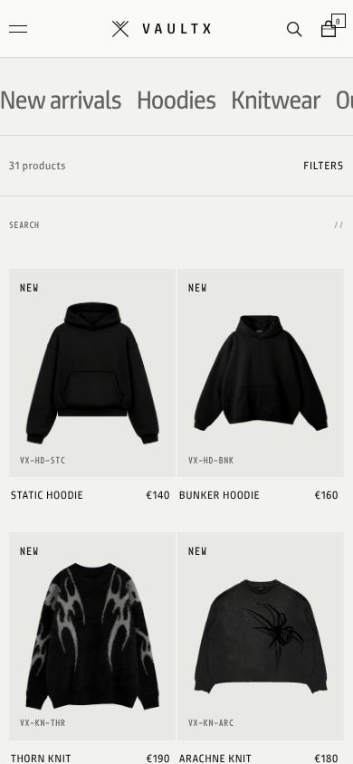
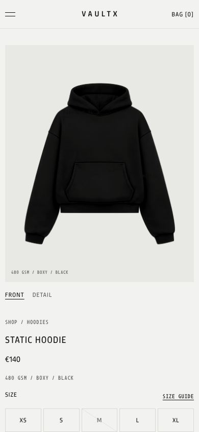

<div align="center">

# VAULTX

**Dystopian streetwear store in black and white.**

[**Live site**](https://denysovski.github.io/VaultX/) &nbsp;·&nbsp; [Shop](https://denysovski.github.io/VaultX/shop/) &nbsp;·&nbsp; [Product](https://denysovski.github.io/VaultX/shop/breach-leather-jacket/)


</div>

## Description

> Black and white dystopian streetwear store. React + TypeScript single-page app with a glitch video hero, live tracker boxes, prerendered routes, localStorage accounts and a custom checkout.

**Tags:** `react` `typescript` `vite` `ecommerce` `streetwear` `fashion` `dystopian` `black-and-white` `minimal` `spa` `prerendering` `seo` `canvas` `glitch-effect` `localstorage` `checkout` `responsive-design` `github-pages`

## What's inside

- **Landing page** with a black and white video. Tracker boxes follow the clothes (hat, pockets, sleeve).
- **Shop** with filters on the side. Mix categories, sizes and a price range.
- **Search** right in the top bar.
- **Product page** with sizes, stock and a size guide.
- **Bag and checkout** with custom forms. Nothing is really paid.
- **Account** with sign up, sign in, "remember me" and password change.
- **Help page** for tracking orders and reporting delivery problems.
- **About us** and pages for creators, artists and designers who want to work with us.
- **Newsletter popup** with a code for the first order.
- Works on phone, tablet and desktop.

## Style

- **Colours:** black, white and greys only.
- **Fonts:** [Expose](https://www.fontshare.com/fonts/expose) for text, [RX100](https://www.fontshare.com/fonts/rx-100) for the small HUD labels. No bold headers.
- **Effects:** thin grid lines, + markers, small scattered text, blur and fade-in animations.


## Screens

| | |
|---|---|
|  |  |
|  |  |
|  |  |
|  |  |

| | | | |
|:---:|:---:|:---:|:---:|
|  |  |  |  |

## Accounts

Everything is saved in your browser, there is no server.

- Passwords are hashed, never saved as typed.
- **Remember me** keeps you signed in for 30 days. Without it you are signed out when the browser closes.
- You are signed out after 2 hours without activity.
- 5 wrong passwords lock the account for 5 minutes.

## Try the checkout

- Card `4242 4242 4242 4242`, any future date, any 3 digits.
- Card `4000 0000 0000 0002` shows a declined payment.
- Discount code `VAULT10`.

## Tested

- Lighthouse: 95–100 performance, 100 accessibility.
- `npm audit`: 0 vulnerabilities.
- Blocked: injected scripts, HTML in form fields, redirects to other sites.

## Run it

```bash
npm install
npm run dev     # local server
npm run build   # build into dist/
```

Pushing to `main` deploys the site to GitHub Pages.

## Credits

- Product images: Pinterest (linked, not stored here; rights belong to their owners).
- Photos: [Christian Agbede](https://unsplash.com/@chriscreations__) and [Alex Gruber](https://unsplash.com/@alex_gruber) on Unsplash.
- Fonts: Fontshare.
- Hero video: provided by the project owner. Tracking boxes made with OpenCV (`scripts/track-video.py`).

<div align="center"><sub>Portfolio project. Nothing is sold.</sub></div>
